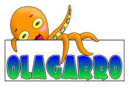
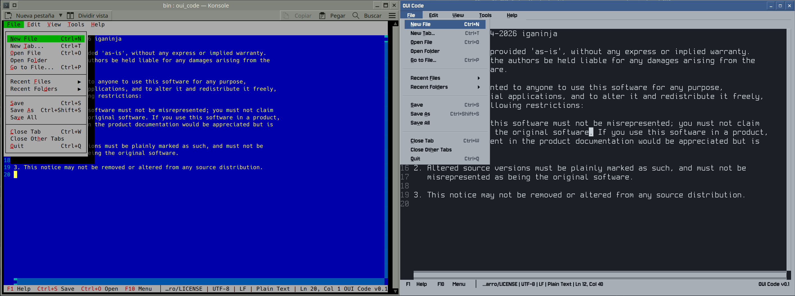

# Olagarro



Olagarro is a small, portable C++17 utility library for games and applications.
Its documentation is in [doc](doc/README.md), in Markdown: OUI Code shows it, its links followed.



OUI Code, the text editor built on OUI, the same program in a terminal and in a window of its own.

## Modules

- `ByteStream`: binary serialization and file I/O.
- `SignalSlot`: variadic signals and slots with safe disconnection.
- `Tasks`: dynamic task composition.
- `CTTasks`: static task composition for small binaries.
- `Concurrency`: standard-library-based `concurrent_for`.
- `OUI`: a small UI toolkit for terminals, desktop windows and the whole screen.
- `OUIScript`: JavaScript for OUI programs, run by QuickJS.

## Install

OUI Code, oui_run and oui_calc come ready to run from the [releases](https://github.com/iganinja/olagarro/releases),
for Linux and Windows on x86-64, for Linux on 64-bit ARM, as a Raspberry Pi 3, 4 or 5 with a 64-bit system, and for
macOS on Apple's processors and Intel's. An installer shows what there is and asks, then downloads it, checks it
against the release's sums and installs it, with no root and no administrator; `install.sh` on Linux and macOS:

```sh
curl -fsSL https://raw.githubusercontent.com/iganinja/olagarro/master/install.sh | sh
```

```powershell
irm https://raw.githubusercontent.com/iganinja/olagarro/master/install.ps1 | iex
```

Each program comes in two kinds, under the same name: for the terminal, and `gui`, which also opens in a window of
its own. Typed in a terminal it stays there, and `--window` opens its window; started from the desktop's menu or an
icon, with no terminal, it opens its window. The installers can also get the whole package, the three programs with their licences,
and take options to choose without asking: `sh -s -- --all --gui` on Linux, `-All -Gui` on Windows, as the head of
each script tells.

On Debian, Ubuntu and the like, apt can keep them up to date: `install.sh` adds the project's APT repository, with
`--apt` or from its menu, or by hand:

```sh
sudo mkdir -p /etc/apt/keyrings
sudo curl -fsSL https://iganinja.github.io/olagarro/olagarro.gpg -o /etc/apt/keyrings/olagarro.gpg
echo "deb [signed-by=/etc/apt/keyrings/olagarro.gpg] https://iganinja.github.io/olagarro stable main" \
    | sudo tee /etc/apt/sources.list.d/olagarro.list
sudo apt update && sudo apt install oui-pack
```

`oui-pack` has the three for the terminal and `oui-pack-gui` the `gui` ones, which also puts OUI Code and OUI Calc in
the desktop's menu; one or the other, in `/usr/bin`. `apt upgrade` brings each new release. Each release also carries them as `.deb` files, for `sudo dpkg -i`.

## Build

```sh
cmake -S . -B build -G Ninja
cmake --build build
ctest --test-dir build --output-on-failure
cmake --install build --prefix /path/to/install
```

On Linux, `tools/build.sh` does the same; `tools/build.sh --gui` builds the programs able to open in a desktop window
as well, as `bin/oui_code_gui` and the rest.

Each release carries OUI Code, oui_run and oui_calc for Linux and Windows on x86-64, for Linux on 64-bit ARM
(aarch64) and for macOS (arm64 and x86_64), each in two kinds: `terminal`,
which runs in the terminal it is started from, and `gui`, which also opens in a window of its own with `--window`. They
come together in a package for each system and kind, as `olagarro-linux-x86_64-gui.tar.gz`, and each alone, as
`oui_code-windows-x86_64-terminal.exe`, and need nothing installed beside them: OUI Code is 2.1 MB in the terminal
kind for Linux. GitHub builds them from a version's tag, as [building](doc/building.md#release-binaries) tells.

## CMake consumer

```cmake
find_package(Olagarro CONFIG REQUIRED COMPONENTS Tasks SignalSlot)

target_link_libraries(my_app PRIVATE
    olagarro::Tasks
    olagarro::SignalSlot)
```

## ByteStream

```cpp
olagarro::ByteStream stream{};
stream.write(42).write(3.5f);

const int answer{stream.read<int>()};
const float value{stream.read<float>()};
```

## Tasks

```cpp
using namespace olagarro::tasks;

TaskExecutor executor{};
executor.add_task(serial(
    wait(1.0f),
    execute([] {})));
executor.update(1.0f);
```

## OUI

OUI builds text-mode applications that run in any terminal, locally or over SSH,
on Linux and Windows. It is event driven and uses no CPU while idle.

- Widgets: labels, buttons, check buttons, line and multi-line text editors,
  combo boxes, lists, tables, tree views, tabs, scroll views and a status bar.
- Layout: rows, columns, grids and a dock layout; windows can be moved and
  resized, with the mouse or from the keyboard after Ctrl+L, and remember where
  the user left them.
- Commands: one registry feeds keyboard shortcuts, a menu bar with separators,
  mnemonics and dynamic submenus, and a command palette.
- Dialogs: message boxes, prompts, and open, save and folder dialogs.
- Text files: load and save keep their encoding and line endings, and saving
  replaces the file atomically.
- Text editing: syntax colouring through a highlighter that works line by line,
  several cursors, bracket matching, search with regular expressions.
- Split views that nest, timers that cost nothing while they wait, and child
  processes whose output arrives on the UI thread as it comes.
- A terminal in a widget (`TerminalView`): a shell, or any program, runs in a
  pseudo-terminal of its own, and the widget shows its screen as xterm would,
  colours, the full-screen programs' alternate screen and the history included.
- Every user-facing string and colour comes from options or the theme.
- Translations: texts go through `translate(context, text)` and come from JSON
  catalogs built into the program (`olagarro_embed_files` in CMake). OUI
  ships Spanish for its own texts, and a test checks that every catalog covers
  every text in the sources.

- Graphics (`olagarro::OUIGraphics`): the same program can show itself in
  pixels instead of a terminal. Widgets ask the painter for elements (a
  button, a window frame, a tab, a scrollbar) and the painter decides how they
  look: a terminal with characters, a graphical style with bevelled shapes,
  interface text in a proportional font and cells in a monospace one, both
  built in. The default look is inspired by Transport Tycoon; themes change at
  run time. Layout stays in cells, so nothing else changes.
- A desktop window (`olagarro::OUIWindow`, with `OLAGARRO_OUI_WINDOW=ON`):
  SDL3 opens it and brings the keyboard and the mouse; OUI draws everything
  inside it, its frame and title bar too, and the desktop still moves and
  resizes it as any other. SDL3 is linked statically, from an installed copy or fetched and
  built with only what a window needs.
- The whole screen, with no desktop under it (`drm_backend`, Linux, with
  `OLAGARRO_OUI_DRM=ON`): straight through the kernel's mode setting and input
  devices, with nothing but Linux's headers, for a console or a system of its own.
- OUI's own desktop (`DesktopServer` and `desktop_backend`, Linux): one program
  has the screen and shows the others' windows, which draw in memory shared
  with it and hear their input from it through a local socket. They share its
  clipboard, and name their windows as the task bar shows them. In a terminal,
  as over SSH, the same desktop shows in characters, and its programs draw cells.

`examples/oui_code` is OUI Code, a text editor built on it; `examples/oui_term` is a terminal; `examples/oui_calc`
a calculator, a prompt that works out what is written on it, as `(800*0.16) - (0.32*500)` or `interes = 800*0.03`,
and keeps it in a log; and `examples/oui_desktop` the desktop, with a task bar that starts them in windows: in a
window of another desktop with `--window`, on the whole screen of a Linux console with `--drm`, or in characters
with `--terminal`, over SSH too.

```cpp
olagarro::oui::Application application;
auto window{olagarro::oui::window("Hello")};
window->add(olagarro::oui::label("Hello from OUI"));
application.set_window(std::move(window));
return application.exec();
```

## OUIScript

OUIScript runs JavaScript in [QuickJS-ng](https://github.com/quickjs-ng/quickjs), vendored in
`third_party/quickjs-ng` under its MIT licence. C++ defines what scripts can call; scripts hand back values
C++ reads and functions it calls later. Each run has a time limit, so a script that loops forever fails
instead of hanging the program.

```cpp
olagarro::oui::script::ScriptEngine engine;
engine.define("app.greet", [](const std::vector<olagarro::oui::script::Value>& arguments)
              {
                  std::cout << "Hello, " << arguments.at(0).to_string() << '\n';
                  return olagarro::oui::script::Value{};
              });
engine.run(R"(app.greet("terminal");)", "hello.js");
```

`RuleHighlighter` colours text by states of regular expression rules, as definitions of languages in
scripts describe them; OUI Code defines its languages and text commands this way.

`examples/oui_run` runs JavaScript the way node does: `console.log` writes to the terminal, commands run with
their output as it comes, and the program ends when the script and what it started are done. Scripts are modules
and import each other with relative paths. A script that wants more opens a window with `oui.window()` and builds
it from OUI's widgets, in the terminal or, built with the window module and run with `--window`, on the desktop.
`examples/oui_run/hello.js` is a plain script and `demo.js` a small panel. [Scripting](doc/scripting.md) shows how
things are done, [the API reference](doc/oui_api.md) lists every name, and `examples/oui_run/recipes` has whole
scripts for common jobs: searching and replacing in files, CSV and JSON, a command's output, renaming, a window;
`examples/oui_run/programs` small programs: the game 2048, a process viewer, a file browser and a to-do list.
`oui/oui.d.ts` has the API as TypeScript declarations, which editors read. Built for size (MinSizeRel, link-time
optimisation, unused sections dropped, stripped) it is about 1.2 MB for the terminal and 2.8 MB with the window.

## Concurrency

`concurrent_for` spreads the elements of a range over the machine's cores and returns a future. Each call
gets an element and its index.

```cpp
// Every element processed in place.
std::vector<Image> images{load_images()};
auto resizing{olagarro::concurrency::concurrent_for(images.begin(), images.end(),
    [](std::size_t, Image& image) { image = resize(image, 640, 480); })};
// ...other work while the images resize...
resizing.get(); // waits, and rethrows the first exception a worker threw

// A value from each element, folded into one: the longest word of a book.
const std::vector<std::string> words{split_words(book)};
const auto longest{olagarro::concurrency::concurrent_for(words.begin(), words.end(),
    [](std::size_t, const std::string& word) { return word.size(); },
    olagarro::concurrency::reductor(std::size_t{0},
        [](std::size_t longest, std::size_t size) { return std::max(longest, size); }))
    .get()};
```

The functions run on several threads at once, so they must not touch shared state unguarded. The combine of
a `reductor` must give the same result however the values are grouped, as a sum or a maximum does; its initial
value counts once. `concurrent_for` requires random-access iterators. Use `std::async` for a single
asynchronous operation.

See [CONTRIBUTING.md](CONTRIBUTING.md) for the project conventions.

## Licence

Olagarro is under the zlib licence, in [LICENSE](LICENSE). What it carries of others' keeps its own:

| What | Where | Licence |
|------|-------|---------|
| QuickJS-ng, the JavaScript engine | `third_party/quickjs-ng` | MIT, in its `LICENSE` |
| stb_truetype, which reads the interface font | `third_party/stb` | MIT or public domain, at the end of the file |
| Spleen, the cell font | `oui/fonts/spleen_*` | BSD 2-clause, in `oui/fonts/spleen_license.txt` |
| Jersey 10, the interface font | `oui/fonts/jersey10_regular.ttf` | SIL Open Font License 1.1, in `oui/fonts/jersey10_ofl.txt` |
| SDL3, fetched and linked in only with `OLAGARRO_OUI_WINDOW=ON` | not in the repository | zlib |
